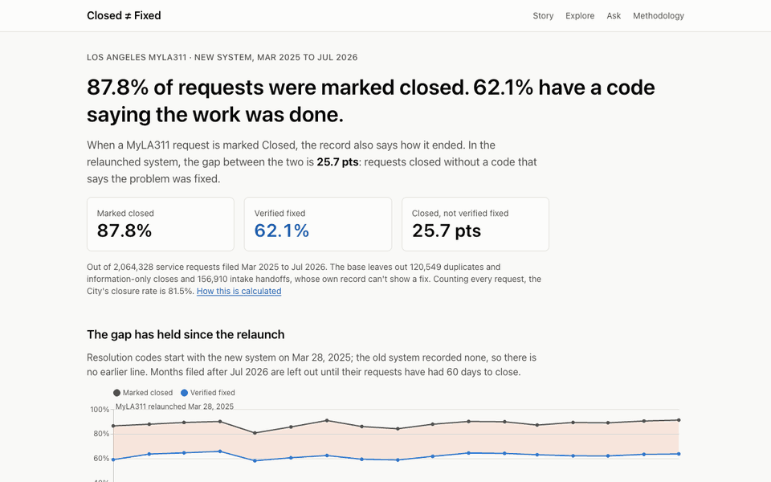
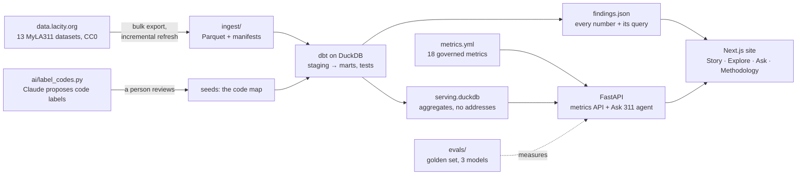

# Closed ≠ Fixed

**When Los Angeles marks a MyLA311 service request "Closed," how often was the problem fixed?**
In the relaunched system, 87.8% of requests filed Mar 2025 to Jul 2026 were
marked closed, but only 62.1% carry a resolution code saying the work was done: a
**25.7-point gap** between closed and fixed.

**Live: [la311-closed-vs-fixed.vercel.app](https://la311-closed-vs-fixed.vercel.app)** — the
story, an explorer, an AI analyst that shows its queries, and the methodology.



Unofficial; not affiliated with the City of Los Angeles. Data: the City's MyLA311 open data on
[data.lacity.org](https://data.lacity.org) (CC0), through Oct 28, 2026. Every number in this README
is generated from [`findings/findings.json`](findings/findings.json), which stores the query
behind each one (`make packaging`).

## Why now

- **New system, new data.** On Mar 28, 2025, LA relaunched MyLA311 with a new platform and app
  ([ABC7](https://abc7.com/post/los-angeles-311-city-upgrades-system-unveils-new-app-service-requests/16099411/)).
  The new system publishes a resolution code on each case, so the public data now says *how* a
  case was closed. The old system published only a status.
- **"Closed" is becoming an official KPI.** In April 2026 the City Council unanimously asked for
  quarterly reports on requests received and closed, backlogs and response times, after staff
  reported problems logging their work in the new system
  ([LAist](https://laist.com/news/politics/officials-aim-to-fix-tech-problems-in-myla311-los-angeles-service-request-system)).
- **A known problem.** The City Controller's audit *The 411 on 311* found that 311 agents' most
  common complaint was "incomplete or incorrectly closed service requests," and recommended
  surveying residents when a request is closed ([controller.lacity.gov](https://controller.lacity.gov/audits/311)).

This project measures what "closed" does and doesn't tell you.

## Three findings

1. **A few codes carry the gap.** Five resolution codes account for 94% of the
   530,965 requests closed without evidence of a fix. "QC-Item Not Out" (a bulky item
   pickup where nothing was out to collect) alone carries 60%.
2. **"Item not out" depends on where.** It closed 24% of bulky and dumped item
   pickups overall, from 11% to 40% across 98 neighborhood councils, but only
   23% to 27% across weekdays.
3. **Graffiti closes more slowly since the relaunch.** Resident-reported graffiti closed within 30
   days fell from 74% in the year before the relaunch to 65% in
   the year after the overlap, while cancellations fell from 23% to
   15%.

Descriptive only: none of this says *why*, and none of it judges a person or crew. The one-page
memo is [`findings/MEMO.md`](findings/MEMO.md); the five-minute version is
[`docs/CASE_STUDY.md`](docs/CASE_STUDY.md).

## How it works



- **Ingest:** a Typer CLI pulls the 13 MyLA311 datasets (every year since 2015, across two
  systems), pins each dataset's schema and saved filter, and reconciles row counts against the
  portal.
- **Warehouse:** dbt on DuckDB (staging → intermediate → marts), with the reviewed decisions in
  seeds: the resolution-code map, the status map and the old-to-new category crosswalk. A new,
  unmapped resolution code fails the build.
- **Taxonomy:** every resolution code maps to one of 11 outcome classes. Claude labeled all
  171 codes (Haiku twice, Sonnet on disagreement, $0.19 in total) and a person reviewed
  every label; the AI matched the reviewed map on 94.7% of codes (99.7% of
  requests).
- **Metrics:** `metrics.yml` defines each rate once (18 metrics) and `api/metrics.py`
  compiles it to parameterized SQL. The site, the findings and the agent all use it.
- **Ask 311:** a Claude agent that answers only through tools (governed metrics first; read-only
  SQL over aggregate tables as an escape hatch), shows its trace, and links every key number to
  its query. Its final answer is structured output, and code checks that every number in it came
  from a tool result before it's shown.
- **Guardrails:** the key stays server-side; 10 live questions an hour per IP; a
  $1.00 daily spend cap and a kill switch; at most 8 steps per answer; cached
  answers for the suggested questions; traces with hashed IPs only.
- **Evals:** 43 questions (numeric, must-qualify, must-decline, 5 in Spanish)
  with expected answers computed from the data at run time.

| model | numbers correct | all checks | cost per question | median time |
|---|---|---|---|---|
| claude-haiku-5-5 | 94% | 93% | $0.0012 | 7.2 s |
| **claude-sonnet-5-5** (deployed) | 100% | 100% | $0.0123 | 5.7 s |
| claude-opus-5-5 | 100% | 95% | $0.0337 | 10.2 s |

## Run it

Requires [uv](https://docs.astral.sh/uv/), make and Node.js.

```sh
make setup          # Python env, dbt packages, git hooks
make check          # lint + offline tests (a real dbt build on synthetic fixtures)
make ingest         # full pulls of every dataset (slow); `make refresh` for deltas
make build          # dbt build → data/warehouse.duckdb
make findings       # serving.duckdb, then findings/findings.json and MEMO.md
make serve          # the API on :8000 (Ask needs ANTHROPIC_API_KEY in .env)
make web            # the site on :3000
make eval MODEL=claude-sonnet-5-5   # the golden set (spends API credit)
make packaging      # re-render this README and the docs from the numbers
```

Deploys go to Vercel as one project with two services (`vercel.json`): the Next.js site and the
FastAPI service, which downloads the serving data from a pinned GitHub Release. Decisions are
in [`docs/DECISIONS.md`](docs/DECISIONS.md) and every data quirk in
[`docs/DATA_NOTES.md`](docs/DATA_NOTES.md).

## What I'd do with internal data

- **Join closures to work-order systems** (crew logs, timestamps, completion notes) to check
  whether a "work done" code matches work actually recorded in the field, and what "closed
  without saying how" usually means for each bureau.
- **Use closure photos** where crews take them, to label a sample of closures as fixed or not and
  measure how often each resolution code is right.
- **Add the closure survey the Controller recommended:** ask residents whether the problem was
  fixed, then compare their answers with the codes. That turns "verified fixed" from what the
  record says into what residents saw.

## Repo

`ingest/` pulls · `dbt/` warehouse · `ai/` code labeling and the agent · `api/` FastAPI ·
`web/` the site · `evals/` golden set and results · `findings/` the numbers and these docs ·
`docs/` decisions, data notes, case study, demo script, resume bullets, interview prep.

Code is MIT-licensed; the City's data is CC0. Built by Skye Jackel-Marken with Claude Code.
